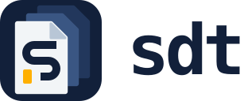
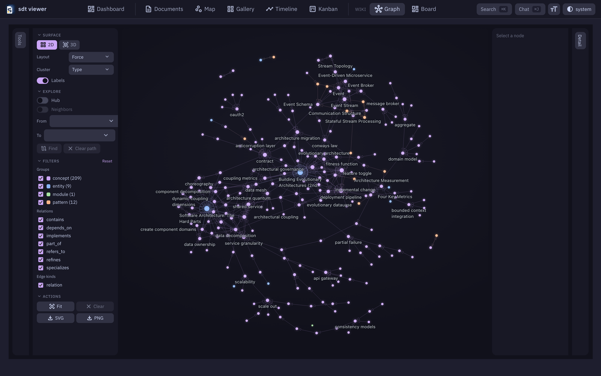
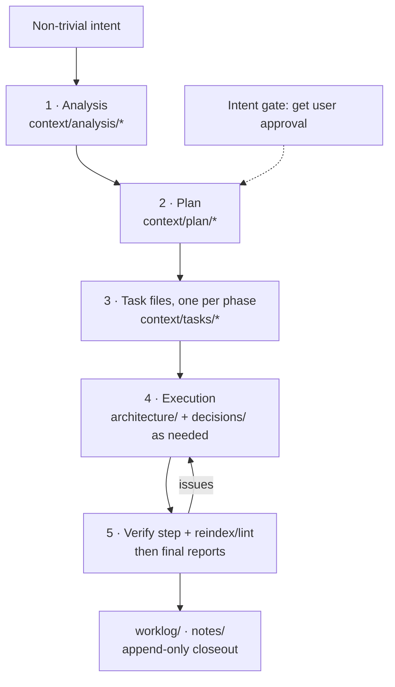
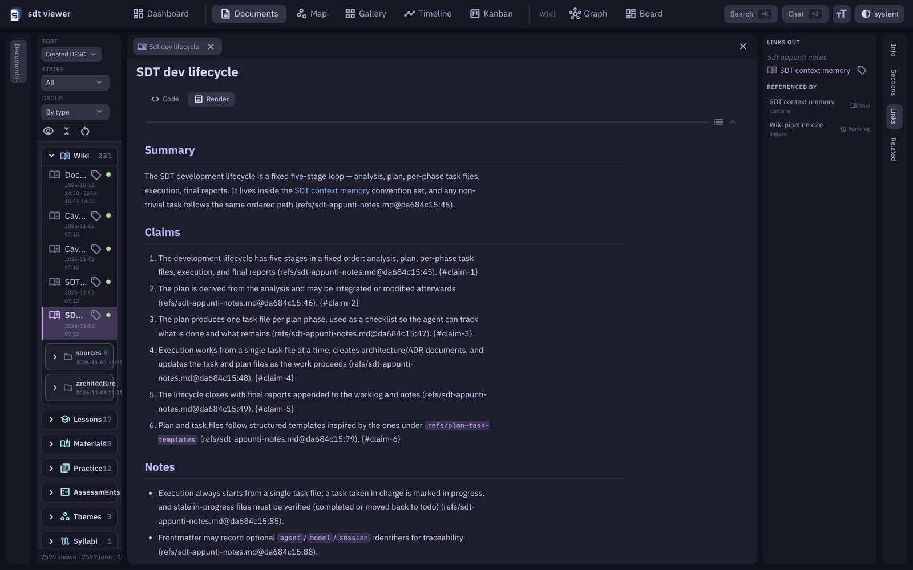
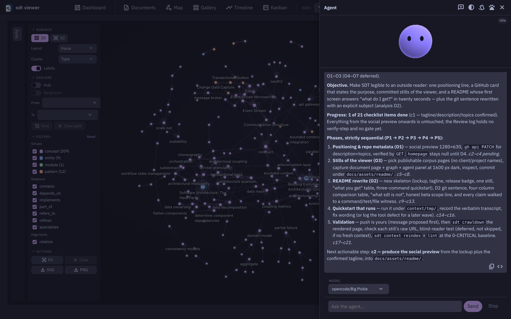
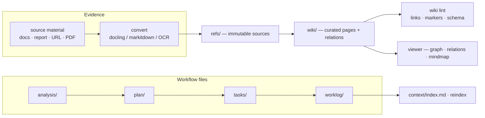

# sdt

[](https://github.com/sandrolain/sdt/actions/workflows/ci.yml)
[](https://github.com/sandrolain/sdt/actions/workflows/security.yml)
[](https://github.com/sandrolain/sdt/releases)
[](https://goreportcard.com/report/github.com/sandrolain/sdt)
[](LICENSE)

**Your agent's reasoning, kept in the repository — not in the chat.**





`context/` graph of a real corpus — every node a document, every edge a checked relation.

## What you get

| You get | How it works |
|---|---|
| **Reasoning that survives the session** — analyses, plans, decisions and tasks live as Markdown under `context/`, next to the code | A five-stage loop enforced by the binary: intent → analysis → plan → tasks → reports. Status is a state machine in the CLI, not a habit (`sdt context status set` validates against per-kind vocabularies) |
| **A viewer over the whole corpus** — tree, search, wiki graph (2D/3D), mindmaps, board and a live agent chat beside the page | `sdtviewer` serves your `context/` read-only on loopback — no database, no hosted service |
| **Delivery that is certified, not claimed** — unfinished work cannot pass as done | Deterministic lint (`sdt context lint`), instruction verification (`sdt agent verify`) and a delivery gate (`sdt agent gate`: build → vet → lint → test) refuse to certify what no check supports |

## Quickstart

```bash
go install github.com/sandrolain/sdt@latest
cd your-project
sdt agent init --project my-project --group my-project --yes
```

Bootstrap writes `.sdt.yaml`, `AGENTS.md` and the `context/` skeleton — conventions agents read first (`--project`/`--group` name the project and its grouping scope; `--yes` takes the defaults). Requires Go 1.27+. Then put one real question in:

```bash
sdt context new --type analysis --title "Why checkout drops sessions on Safari" \
  --summary "Reproduce the Safari session drop and decide the fix."
sdt context list --type analysis
# context/analysis/20261112-115842-why-checkout-drops-sessions-on-safari.md
```

That file now carries sources, links and a status your linter and your agents can check. See it in the browser:

```bash
task build-viewer      # needs Bun; produces bin/sdtviewer
bin/sdtviewer serve --open
```

## What sdt is not

- **Not a hosted service** — everything runs locally from your repository; no account, no daemon, no cloud sync.
- **Not a chat-memory plugin** — it is a workflow with gates; the agent's reasoning lands in reviewable files, not in a prompt side-channel.
- **Not an all-or-nothing framework** — bootstrap once, then each command works standalone in pipelines and scripts.

## How it compares

| What you need | sdt | Spec-driven template kits | Note-taking knowledge bases |
|---|---|---|---|
| Intent → analysis → plan → task trail the agent cannot skip | Enforced: status machine + lint + gate in the binary | Templates and prompts — enforcement is the agent's goodwill | Not their concern |
| Provenance on every claim | `sources`/`links` frontmatter, lint-checked | Partial | Good — but outside the repository |
| A browsable corpus: graph, mindmaps, search, agent beside the page | Local viewer over the same files | None | Their app, hosted or desktop |
| Where the knowledge lives | Your repo — plain Markdown your `git` already versions | Your repo (templates) | An external store |

## Orientation

SDT is **local-first, agent-aware and evidence-driven**:

- **Local-first** — knowledge stays in the repository as readable files; the workflow works offline, with no database or remote service.
- **Agent-aware** — commands, schemas, generated instructions and role profiles are designed for human and machine consumers, with explicit contracts and deterministic output (`--format json|yaml|text`).
- **Evidence-driven** — documents carry their sources and provenance; the delivery gate is a mechanical check, and `git blame` disciplines memory the same way it disciplines code.

### The lifecycle



Three principles behind it: **files are the source of truth** (plain Markdown with YAML frontmatter — diffable, reviewable, greppable; the file is always canonical); **evidence over authority** (analyses feed plans, plans produce task files, tasks close only through the verify-step, and every conclusion can be walked back to its sources); **humans stay in control** (the plan is approved by the user, and decisions that change the project remain human decisions).

## The viewer



Standalone `sdtviewer` (source-built, see Quickstart) serves the corpus read-only: document tree with state filters, fulltext and hybrid lexical+semantic search, the wiki graph above, per-page mindmaps, a JSON Canvas board — and, optionally, an agent chat.

**Status: beta.** The CLI is stable for daily use; the viewer is built from source until it ships in the release artifacts, and the wiki knowledge engine is a pilot over one domain.



### Agent chat (optional)

The project declares which agent it runs, and the viewer starts it when a reader first asks — no process exists before that:

```yaml
# .sdt.yaml
agent:
  command: ["opencode", "acp"]   # an argv list, executed directly — no shell
  model: "opencode/big-pickle"   # optional: absent means the agent's own default
```

The viewer speaks ACP over the agent's stdio, asks for your approval on every tool the agent wants to run, confines file access to the project root, refuses terminals outright, and accepts requests only from its own page on a loopback bind. Architecture: `context/architecture/agent-bridge-acp-chat-panel.md`.

## Features

- **Typed document registry** — create, list, search, reindex and lint the corpus through one uniform CLI (`sdt context …`); statuses are validated per kind, and 18 document kinds cover analyses, plans, decisions, wiki, research, worklog and more (`sdt context status vocab`).
- **Search that reaches meaning** — ranked section-level search fusing a lexical index with semantic embeddings (RRF) from built-in pure-Go models: no downloads, no network (`sdt context search --semantic`).
- **Agent instructions as generated artefacts** — `AGENTS.md`, per-command docs, instruction files and role profiles are generated from templates and verified against the binary (`sdt agent verify`, `sdt agent doctor`).
- **Wiki pipeline** — ingestion converts sources (docling / markitdown / OCR) into wiki pages with checked relations; `refs/` keeps the immutable evidence (`sdt context ingest`, `sdt context wiki lint`).
- **A developer toolbox on the side** — deterministic commands for encoding, hashing and cryptography, JWT handling, conversions, templating and network diagnostics, all pipe-friendly with machine-readable output.
- **Zero CGO, cross-platform** — pure Go; Linux, macOS, Windows.

2,191 Go tests at 85% coverage (`go tool cover -func`), a security workflow (`.github/workflows/security.yml`) and golden tests pin the behaviour the gates certify.

## Installation

```bash
go install github.com/sandrolain/sdt@latest
```

Build from source:

```bash
git clone https://github.com/sandrolain/sdt
cd sdt
task build                            # CLI -> bin/sdt
task build-viewer                     # web SPA + embed + sdtviewer -> bin/sdtviewer
```

## Documentation

- `docs/` — per-command reference (regenerate with `sdt docs`)
- `context/instructions/cli.md` — curated CLI usage and examples for agents
- `context/wiki/` — curated project knowledge distilled from source material
- `AGENTS.md` — conventions for agents working on this repository
- [CONTRIBUTING.md](./CONTRIBUTING.md) — contribution guidelines

## Development

```bash
# Build CLI (+ optional viewer)
task build
task build-viewer

# Tests (≥80% coverage required; context/refs holds an immutable clone, so
# scope out /context):
go test $(go list -e ./... | grep -v /context/) -coverprofile=coverage.out
go tool cover -func=coverage.out
cd web && bun run test

# Lint + format + vulnerabilities
golangci-lint run ./cli/... ./viewer/... ./internal/... .
gofmt -w ./cli ./internal ./viewer ./main.go
govulncheck ./...
cd web && bun run lint && bun run fmt:check
```

## Context & Knowledge

Project knowledge lives under `context/` as versioned Markdown files. The directories that matter most:

- `analysis/`, `plan/`, `tasks/` — the intent-to-execution chain
- `decisions/` — Architecture Decision Records (ADRs), append-only
- `architecture/`, `research/`, `proposals/` — living docs, investigations, RFCs
- `wiki/`, `refs/` — curated knowledge pages with checked relations, and the immutable sources behind them
- `worklog/`, `notes/`, `questions/` — append-only reports, lessons and open questions
- `instructions/`, `roles/` — generated agent instructions and role profiles
- `index.md` — generated knowledge index (entry point; `sdt context reindex`)



Use `sdt context reindex` to regenerate the index and `sdt context lint` /
`sdt context wiki lint` to validate document structure. Full reference:
`sdt context --help`.

In your project the knowledge lives in `context/` as Markdown your `git` already versions — `git diff`, `git blame` and review work on it unchanged.

## License

[MIT License](LICENSE) — Copyright (c) 2025 Sandro Lain
